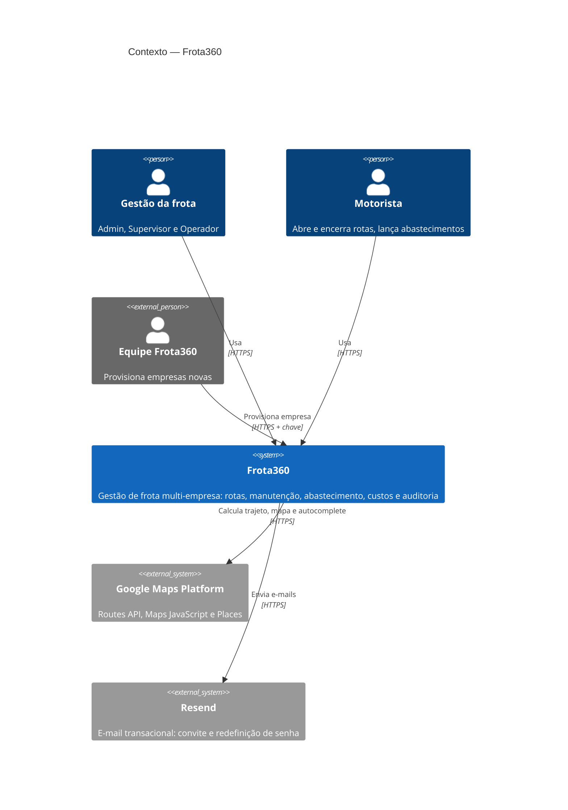
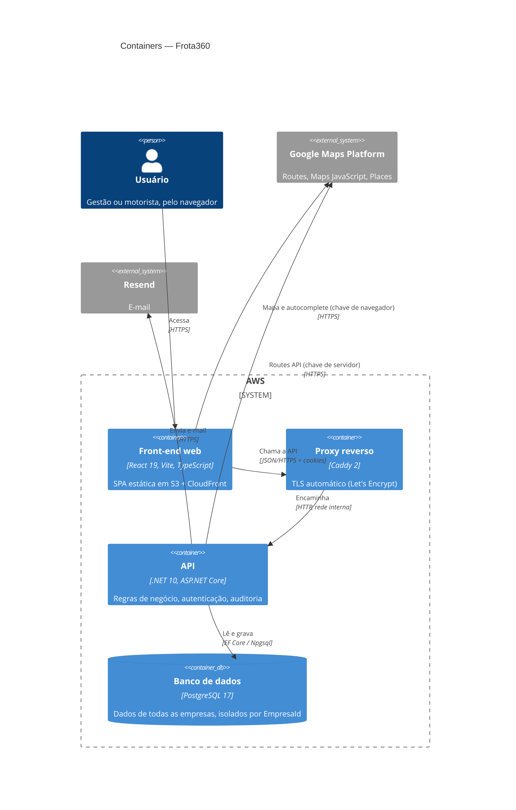
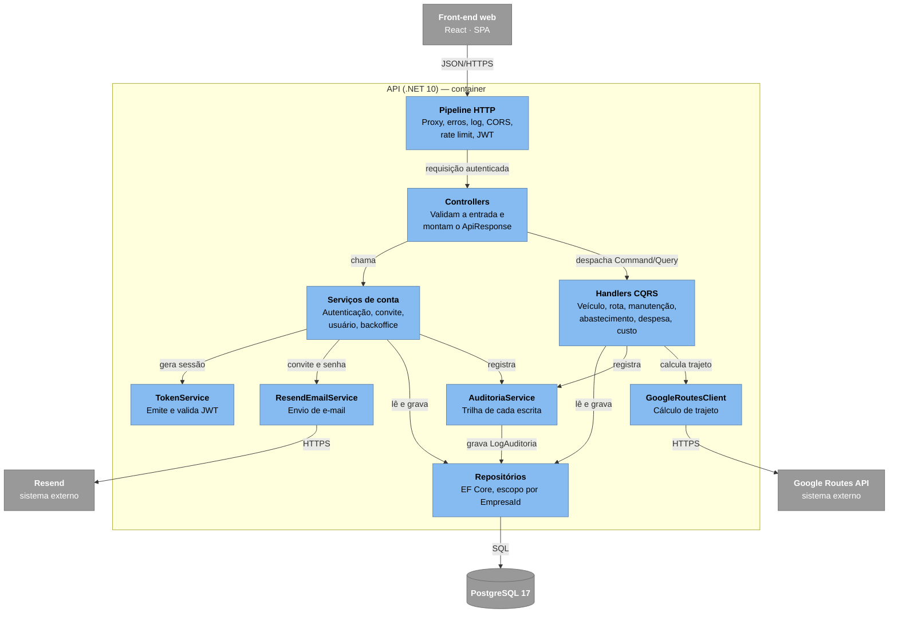

# Arquitetura

O Frota360 é um monorepo com dois aplicativos: uma **API REST em .NET 10** e uma **SPA em React 19**. Os dois vivem juntos porque quase toda mudança de um lado exige mexer no outro no mesmo commit ([ADR-010](ADR-010-Monorepo)).

```
apps/
├── api/    backend .NET 10 — Domain, Application, Infrastructure, Api + 3 suítes de teste
└── web/    front React 19 + Vite
docs/       RFC, contexto profundo de cada app, roteiro de deploy
wiki/       fonte desta Wiki
```

## C4 — Nível 1: Contexto

Quem usa o sistema e com quais sistemas externos ele conversa.



## C4 — Nível 2: Containers

API, banco e proxy rodam numa EC2 única com Docker Compose, e só as portas 80 e 443 ficam expostas. O front é estático, servido por S3 + CloudFront. Detalhes em [Deploy](Deploy) e no [ADR-007](ADR-007-EC2-com-Docker-Compose).



## C4 — Nível 3: Componentes da API

Desenhado como fluxograma com as cores do C4 (azul: componentes; cinza: externos à API), porque o layout automático do C4 no Mermaid cruza as relações.



## Backend em camadas

Clean Architecture em quatro projetos. A dependência aponta sempre para dentro: o Domain não conhece ninguém.

| Projeto | Responsabilidade | Pode referenciar |
| :---- | :---- | :---- |
| **Domain** | Entidades, enums, `ApiResponse<T>`, `ResultadoPaginado<T>`, papéis, vocabulário da auditoria e interfaces de repositório | nada |
| **Application** | Casos de uso em CQRS (`UseCases/`), serviços de conta (`Services/`), DTOs, validators e mapeamentos | Domain |
| **Infrastructure** | `DbContext` do EF Core, repositórios, migrations, JWT, e-mail (Resend), cliente da Google Routes API | Domain |
| **Api** | Controllers, middlewares, leitura da sessão, `Program.cs` | Application + Infrastructure |

### Caminho de uma requisição

```
HTTP → ForwardedHeaders → ExceptionMiddleware → Serilog → CORS → RateLimiter → Autenticação/Autorização → Controller
Controller: valida com FluentValidation → 400 | dispatcher.SendAsync(Command/Query)
  Dispatcher → IRequestHandler<TRequest, TResponse>
    Handler: lê EmpresaId do token → repositório → entidade → auditoria → DTO
Controller embrulha em ApiResponse<T>
```

* **CQRS sem biblioteca.** Um `Dispatcher` próprio resolve o handler pelo tipo da requisição no contêiner de injeção de dependência. Os handlers são registrados por varredura da assembly, então caso de uso novo não exige registro manual.
* **Uma fatia vertical por caso de uso:** `UseCases/<Agregado>/Commands|Queries/<Acao>/` com o comando, o handler e o validator lado a lado.
* **Serviços para o que não é CRUD de domínio:** autenticação, convite, usuário e provisionamento ficam em `Application/Services`.
* **Erros por exceção tipada:** regra de negócio violada vira `InvalidOperationException` → **422** com a mensagem para o usuário; "não encontrado" vira `null` → 404. Detalhes na [Referência da API](Referencia-da-API#erros).

### Regras que atravessam todas as camadas

* **Isolamento por empresa.** Toda consulta recebe o `EmpresaId` do token, e todo id que chega no corpo é resolvido dentro da empresa antes de ser gravado; id de outra empresa simplesmente "não existe" ([ADR-002](ADR-002-Multi-tenant-por-claim)).
* **Segundo eixo para o motorista.** Rotas e abastecimentos também são recortados pelo usuário do token ([ADR-003](ADR-003-Motorista-e-um-Usuario)).
* **Toda escrita é auditada.** O handler registra a intenção de negócio ("Encerrou a rota") ao final do caminho feliz ([ADR-006](ADR-006-Auditoria-explicita-no-handler)).
* **Valor derivado é calculado no servidor.** Valor do abastecimento, km percorrido, situação da manutenção e "em rota" nunca vêm do cliente.
* **O odômetro só avança.** Rota, manutenção e abastecimento comparam antes de gravar.

## Frontend

| Aspecto | Escolha |
| :---- | :---- |
| Build | Vite + React 19 + TypeScript |
| Rotas | React Router, com guardas `RequireAuth` (sessão) e `RequirePode` (papel) por tela |
| Dados | TanStack Query: cada recurso tem chaves de cache, e cada escrita invalida as chaves que afeta |
| HTTP | Axios com interceptor de renovação de sessão; `unwrap()` desempacota o envelope e lança `ApiError` |
| Sessão | Cookies `HttpOnly` definidos pela API — o JavaScript nunca vê o token ([ADR-004](ADR-004-Sessao-em-cookie-HttpOnly)) |
| Estilo | Tailwind sobre um design system próprio |
| Mapas | Google Maps JavaScript + Places, com chave de navegador restrita por domínio ([ADR-008](ADR-008-Integracao-com-Google-Maps)) |

**Permissões no front são só um espelho.** `auth/permissions.ts` esconde botões e telas que o papel não pode usar, mas quem decide é a API. Exemplo de invalidação cruzada: encerrar uma rota invalida rotas, veículos (o odômetro mudou), manutenções (o atraso pode ter mudado) e custos (o km é o denominador do R$/km).

## Contrato entre API e front

Os tipos do front (`apps/web/src/api/types.ts`) são mantidos à mão e espelham os DTOs da API. Por isso uma mudança de contrato entra nos dois lados no mesmo commit.

| Ponto | API | Front |
| :---- | :---- | :---- |
| Envelope | `ApiResponse<T>` (`sucesso`, `mensagem`, `dados`, `erros`) | `unwrap()` |
| Paginação | `ResultadoPaginado<T>` em seis listagens | `usePaginacaoServidor` |
| Papéis | `[Authorize(Roles = ...)]` por ação | `pode.*` |
| Erro de regra | 422 com texto para o usuário | mensagem exibida literalmente |
| Faixa de "vencendo" | `RegrasDeManutencao.FaixaAvisoKm` = 500 | `FAIXA_AVISO` = 500 |

## Integrações externas

| Serviço | Para quê | Quem chama | Falha |
| :---- | :---- | :---- | :---- |
| Google Routes API | Distância, duração e traçado da rota | API (chave de servidor) | 422 com mensagem genérica; a rota pode ser salva sem traçado |
| Google Maps JavaScript + Places | Mapa e autocomplete de endereço | Navegador (chave restrita por domínio) | O campo vira texto livre |
| Resend | E-mail de convite e de redefinição de senha | API | Sem chave configurada, o e-mail só é registrado no log |
