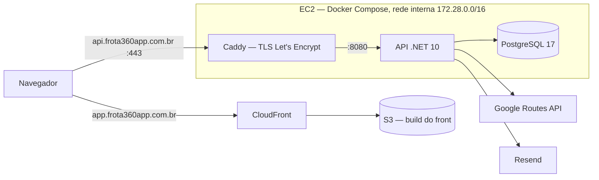
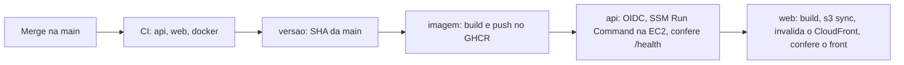

# Deploy

> **Situação em 16/11/2026:** a infraestrutura na AWS e o DNS estão criados, e o pipeline de CD está escrito. Cada merge na `main` passa a publicar a API e o front. Esta página separa o que já existe do que falta.

## Onde cada parte roda

| Peça | Onde | Observação |
| :---- | :---- | :---- |
| API + PostgreSQL + Caddy | AWS EC2 t3.medium, sa-east-1, Docker Compose, IP elástico | Só as portas 80 e 443 são públicas; sem SSH |
| Front (estático) | S3 privado + CloudFront | Com fallback de SPA |
| Imagem da API | GitHub Container Registry (GHCR) | Marcada com o SHA do commit |
| DNS | Cloudflare (domínio `frota360app.com.br`) | `api` e `app` sem proxy |
| E-mail | Resend, domínio `send.frota360app.com.br` | — |

Os motivos de cada escolha estão no [ADR-007](ADR-007-EC2-com-Docker-Compose) e no [ADR-012](ADR-012-Pipeline-de-CD).



## Pipeline de CD

Todo push na `main` cujos checks `api`, `web` e `docker` passam vai para produção. Não há passo manual.



| Etapa | Como |
| :---- | :---- |
| Autenticação na AWS | OIDC: o GitHub Actions assume a role `frota360-deploy`, sem chave guardada. Só o environment `production` deste repositório consegue assumi-la |
| Atualização da EC2 | SSM Run Command (sem porta 22): `git checkout` do commit e `scripts/deploy-ec2.sh`, que baixa a imagem e sobe com `docker compose up --wait` |
| Falha na subida | Se a API nova não ficar saudável, o script volta para a versão anterior e o pipeline falha |
| Front | Build do Vite, `s3 sync` (arquivos com hash em cache por um ano, `index.html` sem cache) e invalidação do CloudFront |
| Verificação | `/health` da API e uma rota do front (`/veiculos`), pedidos de fora da AWS |

A API sobe antes do front: front novo com API antiga é o caso que quebra.

### Rollback

*Actions → deploy → Run workflow*, informando o SHA do commit anterior. A imagem dele já está no GHCR, então o pipeline só troca a versão e republica o front daquele commit.

**Migrations não voltam.** Elas rodam no boot da API. Voltar para antes de uma migration aditiva funciona; para antes de uma destrutiva (coluna removida ou renomeada), não, e essas se corrigem para a frente.

## Arquivos

| Arquivo | Papel |
| :---- | :---- |
| `.github/workflows/ci.yml` | CI; o job `deploy` chama o pipeline em push na `main` |
| `.github/workflows/deploy.yml` | O pipeline de CD; também roda à mão para rollback |
| `scripts/deploy-ec2.sh` | Roda na EC2: baixa a imagem, sobe a stack e volta a versão se a nova falhar |
| `docker-compose.prod.yml` | A stack de produção: `db`, `api` (imagem do GHCR) e `caddy` |
| `docker-compose.local.yml` | Override que ensaia a produção sem domínio, buildando a imagem localmente |
| `Caddyfile` / `Caddyfile.local` | Proxy de produção / do ensaio |
| `apps/api/Dockerfile` | Imagem da API: build multi-stage, usuário sem privilégio, `TZ=America/Sao_Paulo` |
| `.env.example` | Modelo de todas as variáveis de produção |

## Ensaio local

Sobe exatamente a configuração de produção (mesma rede, sem portas expostas, migrations no boot, ambiente `Production`), trocando só o Caddyfile por um que serve HTTP em `localhost` e buildando a imagem em vez de baixá-la. **Faça antes de qualquer mudança em compose, Dockerfile ou pipeline de middlewares** — depois do merge, já é produção.

```powershell
# .env.local com valores descartáveis (modelo em .env.example), contendo ARQUIVO_ENV=.env.local e API_TAG=local
docker stop pg-frota360     # libera a 5432 e a 80

docker compose -f docker-compose.prod.yml -f docker-compose.local.yml --env-file .env.local up -d --build
docker compose -f docker-compose.prod.yml -f docker-compose.local.yml --env-file .env.local logs -f api
```

O que conferir:

| Verificação | Esperado |
| :---- | :---- |
| Log de inicialização | Fuso `America/Sao_Paulo (UTC-03)`, migrations aplicadas, rede confiável `172.28.0.0/16` |
| `docker exec frota360-api whoami` | `app` (não root) |
| `curl http://localhost/health` | `200` |
| `curl http://localhost/scalar/v1` | `404` (documentação fechada fora de desenvolvimento) |
| Criar um registro e ver a auditoria | IP do cliente, não o do Caddy |
| Repetir com `X-Forwarded-For: 1.2.3.4` | O valor forjado é ignorado |
| Parar o banco e reiniciar a API | A API tenta de novo e se recupera quando o banco volta |

Para desfazer: `... down -v` e `docker start pg-frota360`.

## Configuração de produção

Os segredos ficam num `.env` na instância, criado uma vez pelo Session Manager e nunca versionado. A API **não inicia** se faltar configuração obrigatória, e diz o que falta no log:

| Variável | Se faltar |
| :---- | :---- |
| `Jwt__Key` | Não inicia (mínimo 32 caracteres) |
| `ConnectionStrings__DefaultConnection` | Não inicia; o host é `db` |
| `Cors__AllowedOrigins__0` | Não inicia |
| `Frontend__BaseUrl` | Não inicia; é a base dos links de convite |
| `Backoffice__ApiKey` | Não inicia; sem ela não há como criar a primeira empresa |
| `Resend__ApiKey` | Inicia, mas os e-mails só vão para o log |
| `GoogleRoutes__ApiKey` | Inicia; o cálculo de trajeto responde 422 |
| `OTEL_EXPORTER_OTLP_ENDPOINT` / `_HEADERS` | Inicia com aviso; nada chega ao Grafana Cloud — sem painel e sem alerta ([Monitoramento](Monitoramento)) |

O pipeline lê da AWS só identificadores, guardados como variáveis do environment `production` do GitHub: a role, a instância, o bucket, a distribuição e a chave pública do Google Maps.

A primeira empresa é criada pelo backoffice, porque não há usuário semeado:

```bash
curl -X POST https://api.frota360app.com.br/api/v1/backoffice/empresa \
  -H "Content-Type: application/json" \
  -H "X-Backoffice-Key: <Backoffice__ApiKey>" \
  -d '{"nomeEmpresa":"...","cnpj":"...","emailAdmin":"..."}'
```

## DNS e certificados

| Nome | Tipo | Destino | Proxy do Cloudflare |
| :---- | :---- | :---- | :---- |
| `api` | A | IP elástico da EC2 | **Desligado** |
| `app` | CNAME | Distribuição do CloudFront | Desligado |
| raiz e `www` | A fictício + Redirect Rule | 301 para `https://app.frota360app.com.br` | Ligado |
| `send` | Conforme o Resend | Verificação do domínio | Desligado |

* `api` precisa ficar sem proxy: com ele, o desafio HTTP do Let's Encrypt não chega ao Caddy e o certificado nunca é emitido. O security group libera 80 e 443 — a 80 é por onde passa a validação.
* O certificado do front é do AWS Certificate Manager, emitido em us-east-1 (o CloudFront só aceita de lá) e validado por DNS.
* A raiz precisa **redirecionar**, não servir o front: o CORS só aceita `https://app.frota360app.com.br`.
* O HSTS começa curto (1 dia) e só sobe para 1 ano depois de algumas semanas estável.

## Pendências

| Item | Situação |
| :---- | :---- |
| Primeiro deploy pelo pipeline e `.env` da instância | Próximo passo |
| Teste de rollback | Depois do primeiro deploy |
| Verificação do domínio no Resend | Pendente |
| **Backup do PostgreSQL** | Planejado: `pg_dump` diário comprimido para S3 com ciclo de vida, e a restauração testada ao menos uma vez — antes do primeiro dado real do cliente |
| Monitoramento em produção | Instrumentação pronta; falta a stack do Grafana Cloud, o painel, os alertas e o monitor de `/health` ([Monitoramento](Monitoramento#próxima-etapa)) |
| Release `v1.0.0` | Tag na `main` que marca a versão entregue |
