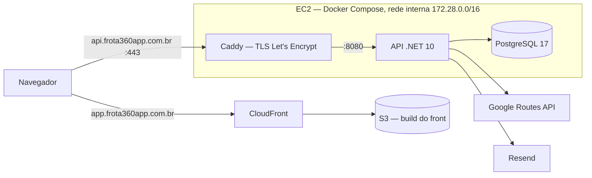

# Deploy

> **Situação em 13/11/2026:** a infraestrutura está definida e ensaiada localmente; a subida na AWS e o pipeline de CD estão em andamento. Esta página separa o que já existe do que falta.

## Onde cada parte roda

| Peça | Onde | Observação |
| :---- | :---- | :---- |
| API + PostgreSQL + Caddy | AWS EC2 t3.medium, sa-east-1, Docker Compose, IP elástico | Só as portas 80 e 443 são públicas |
| Front (estático) | S3 + CloudFront | Com fallback de SPA |
| DNS | Cloudflare (domínio `frota360app.com.br`) | `api` em DNS-only |
| E-mail | Resend, domínio `send.frota360app.com.br` | — |

Os motivos de cada escolha estão no [ADR-007](ADR-007-EC2-com-Docker-Compose).



## Arquivos

| Arquivo | Papel |
| :---- | :---- |
| `docker-compose.prod.yml` | A stack de produção: `db`, `api` e `caddy` |
| `docker-compose.local.yml` | Override que ensaia a produção sem domínio |
| `Caddyfile` / `Caddyfile.local` | Proxy de produção / do ensaio |
| `apps/api/Dockerfile` | Imagem da API: build multi-stage, roda com usuário sem privilégio, `TZ=America/Sao_Paulo` |
| `.env.example` | Modelo de todas as variáveis de produção |

## Ensaio local

Sobe exatamente a configuração de produção (mesma rede, sem portas expostas, migrations no boot, ambiente `Production`), trocando só o Caddyfile por um que serve HTTP em `localhost`. **Faça antes de qualquer mudança em compose, Dockerfile ou pipeline de middlewares.**

```powershell
# .env.local com valores descartáveis (modelo em .env.example), contendo ARQUIVO_ENV=.env.local
docker stop pg-frota360     # libera a 5432 e a 80

docker compose -f docker-compose.prod.yml -f docker-compose.local.yml --env-file .env.local up -d --build
docker compose -f docker-compose.prod.yml -f docker-compose.local.yml --env-file .env.local logs -f api
```

O que conferir:

| Verificação | Esperado |
| :---- | :---- |
| Log de inicialização | Fuso `America/Sao_Paulo (UTC-03)`, migrations aplicadas, rede confiável `172.28.0.0/16` |
| `docker exec frota360-api whoami` | `app` (não root) |
| `curl http://localhost/health` | `200` |
| `curl http://localhost/scalar/v1` | `404` (documentação fechada fora de desenvolvimento) |
| Criar um registro e ver a auditoria | IP do cliente, não o do Caddy |
| Repetir com `X-Forwarded-For: 1.2.3.4` | O valor forjado é ignorado |
| Parar o banco e reiniciar a API | A API tenta de novo e se recupera quando o banco volta |

Para desfazer: `... down -v` e `docker start pg-frota360`.

## Subida na EC2

```bash
cp .env.example .env && chmod 600 .env    # preencher; o .env nunca vai para o git
docker compose -f docker-compose.prod.yml up -d --build

# primeira empresa (não há usuário semeado)
curl -X POST https://api.frota360app.com.br/api/v1/backoffice/empresa \
  -H "Content-Type: application/json" \
  -H "X-Backoffice-Key: <Backoffice__ApiKey>" \
  -d '{"nomeEmpresa":"...","cnpj":"...","emailAdmin":"..."}'
```

A API **não inicia** se faltar configuração obrigatória, e diz o que falta no log:

| Variável | Se faltar |
| :---- | :---- |
| `Jwt__Key` | Não inicia (mínimo 32 caracteres) |
| `ConnectionStrings__DefaultConnection` | Não inicia; o host é `db` |
| `Cors__AllowedOrigins__0` | Não inicia |
| `Frontend__BaseUrl` | Não inicia; é a base dos links de convite |
| `Backoffice__ApiKey` | Não inicia; sem ela não há como criar a primeira empresa |
| `Resend__ApiKey` | Inicia, mas os e-mails só vão para o log |
| `GoogleRoutes__ApiKey` | Inicia; o cálculo de trajeto responde 422 |

## Front

```powershell
cd apps/web
npm run build      # VITE_API_URL vem de .env.production e é embutido no bundle no build
```

No CloudFront, **403 e 404 → `/index.html` com status 200**. Sem esse fallback, qualquer recarga ou link direto (`/veiculos`) quebra, porque o arquivo não existe no bucket (e um bucket privado responde 403, não 404).

## DNS e certificado

| Nome | Tipo | Destino | Proxy do Cloudflare |
| :---- | :---- | :---- | :---- |
| `api` | A | IP elástico da EC2 | **Desligado** |
| `app` | CNAME | Distribuição do CloudFront | Indiferente |
| `send` | Conforme o Resend | Verificação do domínio | Desligado |
| raiz | Redirect 3xx | `https://app.frota360app.com.br` | — |

* `api` precisa ficar sem proxy: com ele, o desafio HTTP do Let's Encrypt não chega ao Caddy e o certificado nunca é emitido. O security group libera 80 e 443 — a 80 é por onde passa a validação.
* A raiz precisa **redirecionar**, não servir o front: o CORS só aceita `https://app.frota360app.com.br`.
* O HSTS começa curto (1 dia) e só sobe para 1 ano depois de algumas semanas estável.

## Pendências

| Item | Situação |
| :---- | :---- |
| Registros DNS, EC2, S3/CloudFront, verificação do Resend | Em andamento |
| **Pipeline de CD** | Planejado: GitHub Actions publica a imagem no GHCR, autentica na AWS por OIDC (sem chave guardada), atualiza a EC2 por SSM Run Command (sem porta SSH) e publica o front com `s3 sync` + invalidação do CloudFront, checando `/health` no fim |
| **Rollback** | Planejado: executar o workflow de deploy manualmente com a tag da versão anterior |
| **Backup do PostgreSQL** | Planejado: `pg_dump` diário comprimido para S3 com ciclo de vida, e a restauração testada ao menos uma vez — antes do primeiro dado real do cliente |
| Release `v1.0.0` | Tag na `main` que dispara o deploy, com a imagem marcada pela mesma versão |
