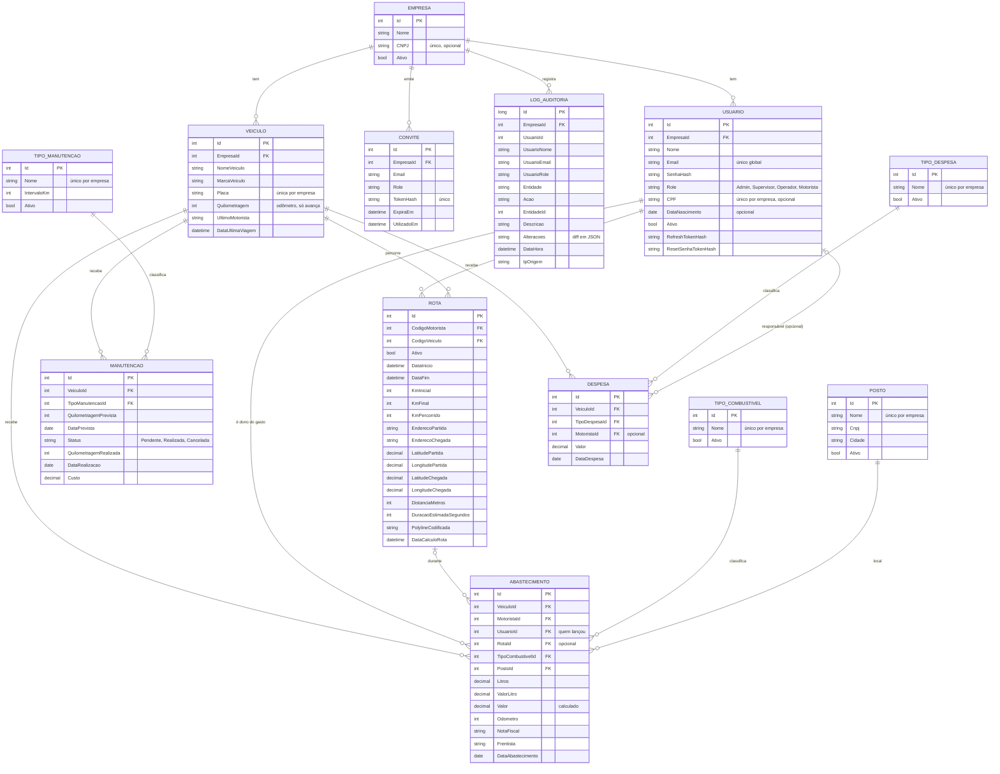

# Modelo de Dados

PostgreSQL 17, mapeado pelo Entity Framework Core. O schema é versionado por migrations em `apps/api/src/Infrastructure/Migrations` e aplicado automaticamente no boot em produção.

## Diagrama entidade-relacionamento

Toda entidade de negócio carrega `EmpresaId`; para legibilidade, as relações com `EMPRESA` aparecem só nas tabelas principais.



## As entidades

| Entidade | Papel no domínio |
| :---- | :---- |
| `Empresa` | O tenant. Tudo pertence a uma empresa. |
| `Usuario` | Quem entra no sistema. **O motorista é um usuário com papel `Motorista`** — não existe tabela de motoristas ([ADR-003](ADR-003-Motorista-e-um-Usuario)). |
| `Convite` | Porta de entrada: e-mail, papel e o hash do token, com validade de 7 dias. |
| `Veiculo` | A frota. `Quilometragem` é o odômetro, que só avança. |
| `Rota` | Uma viagem: motorista, veículo, odômetro inicial e final, endereços e, opcionalmente, o traçado calculado. |
| `TipoManutencao` / `Manutencao` | Catálogo e agenda de manutenção preventiva. |
| `Abastecimento` | Apontamento fiscal de combustível. Separa **o dono do gasto** (`MotoristaId`) de **quem lançou** (`UsuarioId`). |
| `TipoCombustivel` / `Posto` | Catálogos do abastecimento. |
| `TipoDespesa` / `Despesa` | Custos avulsos (pedágio, multa, IPVA, seguro). |
| `LogAuditoria` | Trilha somente-inclusão de toda escrita. Nome, e-mail e papel do autor ficam copiados na linha, para o histórico não mudar de sentido se a pessoa for renomeada. |

## O que não é coluna

Alguns dados aparecem na tela mas são calculados na leitura, de propósito: guardar uma cópia faria o valor envelhecer.

| Dado | Calculado a partir de |
| :---- | :---- |
| Veículo "em rota" | Existe rota ativa sem data de fim para o veículo |
| Manutenção "atrasada" / "vencendo" e km restantes | Quilometragem e data previstas comparadas ao odômetro atual |
| Custo consolidado | União, na consulta, de `Abastecimento.Valor`, `Manutencao.Custo` (só realizadas) e `Despesa.Valor` — não há tabela de custos ([ADR-005](ADR-005-Custos-como-read-model)) |
| Consumo (km/l) | Odômetro e litros dos abastecimentos do veículo, tanque a tanque |

O contrário também acontece: `Rota.KmPercorrido` **é** gravado, porque é fato histórico da viagem e não muda depois do encerramento. Já `Abastecimento.Valor` é gravado, mas sempre recalculado pelo servidor (litros × R$/l).

## Restrições garantidas pelo banco

| Tabela | Restrição | Regra |
| :---- | :---- | :---- |
| `Usuario` | Único em `Email` | RN04 |
| `Usuario` | Único em `(EmpresaId, CPF)` quando o CPF existe | RN03 |
| `Veiculo` | Único em `(EmpresaId, Placa)` | RN02 |
| `Empresa` | Único em `CNPJ` quando existe | — |
| `Convite` | Único em `TokenHash` | RN20 |
| Catálogos (`TipoManutencao`, `TipoDespesa`, `TipoCombustivel`, `Posto`) | Único em `(EmpresaId, Nome)` | — |
| `Rota`, `Manutencao`, `Abastecimento`, `Despesa` | Chaves estrangeiras `Restrict` para veículo e usuário | RN08 — histórico não some em cascata |
| `Abastecimento.RotaId` | Chave estrangeira `SetNull` | Excluir a rota não apaga o gasto |

Os índices únicos são compostos com `EmpresaId`: a mesma placa ou o mesmo CPF podem existir em empresas diferentes. A exceção é o e-mail, que identifica a pessoa no login, antes de haver empresa no contexto.

O handler verifica a unicidade antes de gravar para devolver uma mensagem clara (422); o índice cobre a corrida entre duas gravações simultâneas.

## Tipos e convenções

| Dado | Tipo no banco |
| :---- | :---- |
| Dinheiro | `numeric(10,2)` |
| Litros e R$/litro | `numeric(9,3)` e `numeric(8,3)` |
| Coordenadas | `numeric(9,6)` (~11 cm de resolução) |
| Datas | `timestamp without time zone`, **em hora de Brasília** ([ADR-009](ADR-009-Hora-local-de-Brasilia)) |
| Status da manutenção | Texto (`Pendente`, `Realizada`, `Cancelada`) |
| Id da auditoria | `bigint` |

E-mails são normalizados (caixa e espaços) antes de gravar e de consultar, porque o PostgreSQL compara texto diferenciando maiúsculas.

## Índices de consulta

Além dos únicos, há índices para as consultas que mais rodam:

* `Rota (EmpresaId, Ativo, CodigoVeiculo)` — saber quais veículos estão em rota a cada listagem.
* `Manutencao (EmpresaId, VeiculoId, Status)` — pendências por veículo.
* `Abastecimento` e `Despesa` por `(EmpresaId, VeiculoId, Data)` e `(EmpresaId, MotoristaId, Data)` — filtros da tela e do custo.
* `LogAuditoria` por `(EmpresaId, DataHora)`, `(EmpresaId, Entidade, EntidadeId)` e `(EmpresaId, UsuarioId, DataHora)` — as três consultas da tela de auditoria.

## Migrations

```powershell
cd apps/api
dotnet ef migrations add <Nome> --project src/Infrastructure --startup-project src/Api
dotnet ef database update --project src/Infrastructure --startup-project src/Api
```

Em desenvolvimento a aplicação é manual; em produção as migrations rodam no boot, com novas tentativas enquanto o banco não responde. Toda mudança de schema ganha um teste na suíte de integração, que roda contra um PostgreSQL real ([Testes e Qualidade](Testes-e-Qualidade)).
