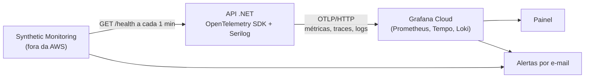

# Monitoramento

> **Situação em 13/11/2026:** a API está instrumentada com **OpenTelemetry** e envia métricas, traces e logs ao **Grafana Cloud** (stack em São Paulo). O painel e as regras de alerta são versionados no repositório e aplicados por script. Falta só o monitor de disponibilidade, que depende da URL pública ([ADR-011](ADR-011-Observabilidade-com-OpenTelemetry)).

## Como funciona



A API não conhece o Grafana. Ela fala **OTLP**, o protocolo aberto do OpenTelemetry, e o destino vem de três variáveis de ambiente padrão. Trocar de ferramenta é trocar o endpoint, sem mudar código.

| Variável | Para quê |
| :---- | :---- |
| `OTEL_EXPORTER_OTLP_ENDPOINT` | Para onde enviar. **Vazia, nada é exportado** e a API segue normal |
| `OTEL_EXPORTER_OTLP_HEADERS` | Autenticação do destino (`Authorization=Basic%20<token>` no Grafana Cloud) |
| `OTEL_EXPORTER_OTLP_PROTOCOL` / `OTEL_SERVICE_NAME` | `http/protobuf` e `frota360-api`, já definidos no `appsettings.json` |

## Os três sinais

| Sinal | De onde vem | Responde |
| :---- | :---- | :---- |
| **Métricas** | ASP.NET Core (requisições por rota e status, duração, rate limit), HttpClient (Google Routes, Resend), Npgsql (pool de conexões, duração dos comandos) e runtime .NET (GC, memória, threads) | Quantas requisições, quanto demoram, quantas falham |
| **Traces** | Cada requisição vira um trace com as chamadas ao banco e às APIs externas dentro dele | Onde o tempo de uma requisição lenta foi gasto |
| **Logs** | Os logs estruturados do Serilog, com as propriedades pesquisáveis (`{VeiculoId}`, `{Placa}`) e o `trace_id` da requisição | O que aconteceu, ligado ao trace que o produziu |

**Nenhum e-mail sai inteiro.** Todo e-mail que aparece num log vira `p***@dominio.com`, no console e no Grafana. O log do e-mail de desenvolvimento, que traz o link com o token de convite, não é exportado ([Segurança e LGPD](Seguranca-e-LGPD)).

**O `/health` fica de fora** dos traces, das métricas HTTP e do log de requisições quando responde 200. Ele é consultado pelo healthcheck do Docker a cada 30 s e pelo monitor externo a cada minuto: incluído, ele inflaria as requisições/s, puxaria a latência para baixo e afogaria os logs de verdade. Quando falha, o log sai como erro.

## O que mais já existe

| Sinal | Como | Onde ver |
| :---- | :---- | :---- |
| **Saúde da aplicação** | `GET /health` responde 200 com a API e o banco de pé | Público, sem autenticação |
| **Saúde detalhada** | `GET /health/detail` — situação de cada verificação, sem expor mensagem de exceção | Público |
| **Logs no servidor** | O mesmo log também vai para o stdout | `docker compose logs api` (rotação de 5 × 10 MB) |
| **Fuso do processo** | A segunda linha do log mostra o fuso efetivo; `UTC` ali indica deploy errado ([ADR-009](ADR-009-Hora-local-de-Brasilia)) | Log de inicialização |
| **Configuração** | A API não inicia sem a configuração obrigatória e lista o que falta. Sem o endpoint OTLP em produção, sobe com um aviso | Log de inicialização |
| **Trilha de negócio** | Toda escrita fica registrada com autor, IP e diff ([ADR-006](ADR-006-Auditoria-explicita-no-handler)) | Tela `/auditoria` (Admin) |

## Painel e alertas como código

O painel e as regras de alerta vivem no repositório, em `infra/grafana/`, e o script `scripts/grafana-provisionar.ps1` os aplica em qualquer Grafana. O mesmo arquivo serve ao Grafana local e ao Grafana Cloud.

| Arquivo | Conteúdo |
| :---- | :---- |
| `painel-frota360.json` | Painel **Frota360 — API**: visão geral do período (requisições, taxa de 5xx, p95, 429, exceções, memória), tráfego por status, latência p50/p95/p99, rotas mais lentas, erros por rota, banco (duração e pool), APIs externas (latência e falhas), rate limit, runtime .NET e os logs de aviso e erro. Filtro por ambiente |
| `alertas-frota360.json` | As quatro regras da tabela abaixo, avaliadas a cada minuto e separadas por ambiente |

```powershell
./scripts/grafana-provisionar.ps1 -EmailAlertas voce@exemplo.com                                    # Grafana local
./scripts/grafana-provisionar.ps1 -Url https://<stack>.grafana.net -EmailAlertas voce@exemplo.com   # Grafana Cloud
```

* **O repositório é a fonte.** As regras ficam travadas na interface do Grafana, como a Wiki: mudou um limite, altere o JSON e rode de novo. O script é idempotente.
* **O e-mail não é versionado.** É dado pessoal, e entra como parâmetro na primeira execução.
* **Na nuvem**, o script usa um token de service account (papel Admin) na variável `GRAFANA_TOKEN`, que nunca é aceito como parâmetro para não ficar no histórico do terminal.

## Próxima etapa

| Peça | Como | Depende de |
| :---- | :---- | :---- |
| Disponibilidade | Synthetic Monitoring consultando `/health` a cada minuto, de fora da AWS | URL pública ([Deploy](Deploy)) |
| Token de produção | Token OTLP próprio no `.env` da EC2, separado do de desenvolvimento | Deploy |

### Indicadores e alertas

| Indicador | Meta | Alerta quando | Situação |
| :---- | :---- | :---- | :---- |
| Disponibilidade de `/health` | 99% em horário comercial (RNF09) | 2 falhas seguidas | Depende da URL pública |
| Latência p95 | < 500 ms (RNF01) | > 1 s, medido em 5 minutos, por 5 minutos | ✅ `frota360-latencia-p95` |
| Taxa de 5xx | < 1% | > 5%, medido em 5 minutos, por 1 minuto | ✅ `frota360-taxa-5xx` |
| Respostas 429 | — | Mais de 20 em 5 minutos (possível força bruta) | ✅ `frota360-pico-429` |
| Falhas em APIs externas (Google Routes, Resend) | — | Mais de 3 em 15 minutos, por destino | ✅ `frota360-integracoes` |

Sem tráfego, as regras ficam em OK: ausência de dado não é alerta. Quem cobre "a API caiu" é o monitor de disponibilidade.

## Em desenvolvimento

Um Grafana completo (Prometheus, Tempo e Loki) roda num container só:

```powershell
docker compose --profile observabilidade up -d          # Grafana em http://localhost:3000 (admin/admin)
cd apps/api
dotnet run --project src/Api --launch-profile observabilidade
```

No Grafana: **Explore → Prometheus** para as métricas (`http_server_request_duration_seconds_count{service_name="frota360-api"}`), **Tempo** para os traces e **Loki** para os logs (`{service_name="frota360-api"}`). As métricas chegam a cada 60 s.

Sem o perfil `observabilidade`, a API roda como antes e não tenta exportar nada.

## Como verificar a saúde à mão

```bash
curl -s -o /dev/null -w "%{http_code}\n" https://api.frota360app.com.br/health
docker compose -f docker-compose.prod.yml ps
docker compose -f docker-compose.prod.yml logs --since 15m api | grep -E "ERR|FTL"
```
