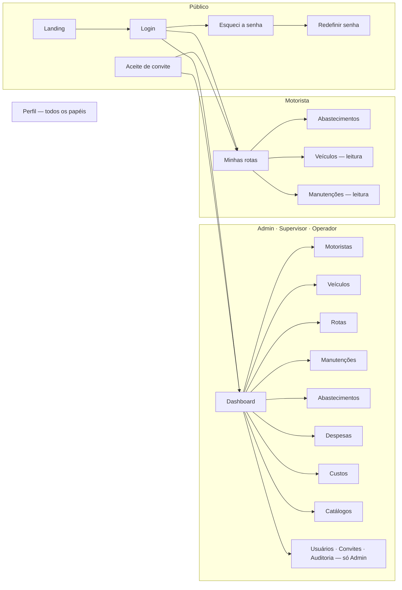

# Telas

O front tem duas faces: o **painel de gestão** (Admin, Supervisor, Operador), que abre no dashboard, e a **operação do motorista**, que abre em "Minhas rotas". Uma pessoa nunca vê as duas.

## Mapa de telas

| Rota | Tela | Quem acessa |
| :---- | :---- | :---- |
| `/` | Página de apresentação | Público |
| `/login` | Entrar | Público |
| `/esqueci-senha` | Pedir redefinição de senha | Público |
| `/redefinir-senha?token=…` | Nova senha (link do e-mail) | Público |
| `/convite?token=…` | Aceite de convite (link do e-mail) | Público |
| `/dashboard` | Visão geral da frota | Gestão |
| `/motoristas` | Motoristas | Gestão |
| `/veiculos` | Veículos | Todos — o motorista só consulta |
| `/rotas` | Rotas | Gestão |
| `/manutencoes` | Manutenções | Todos — o motorista só consulta, sem custo |
| `/abastecimentos` | Abastecimentos | Todos — o motorista vê só os dele |
| `/despesas` | Despesas | Gestão |
| `/custos` | Custos | Gestão |
| `/minhas-rotas` | Minhas rotas | Motorista |
| `/tipos-manutencao`, `/tipos-despesa`, `/tipos-combustivel`, `/postos` | Catálogos | Admin e Supervisor |
| `/usuarios`, `/convites`, `/auditoria` | Administração | Admin |
| `/perfil` | Meu cadastro | Todos |

Os botões de cada tela aparecem conforme o papel, mas quem decide é a API: uma ação fora do papel responde 403 mesmo que alguém a dispare por fora da interface.

## Capturas

As capturas usam a base de desenvolvimento, por isso alguns números (odômetro, consumo) não são realistas.

### Login
A entrada é por convite; não há cadastro aberto.

### Dashboard
Frota em rota, custo e km do mês, custo por km, consumo, manutenções atrasadas e rotas em andamento — cada item leva à tela de detalhe.

### Rotas
Partida e chegada, motorista, veículo, odômetro inicial e final, situação e o botão de encerrar.

### Manutenções
Pendentes primeiro, com o atraso calculado a partir do odômetro atual do veículo.

### Abastecimentos
Apontamento fiscal: combustível, posto, litros, R$/l, odômetro e nota fiscal, com quem é o dono do gasto e quem lançou.

### Custos
Combustível, manutenção e despesas consolidados, com R$/km e km/l por veículo.

### Auditoria
Trilha somente leitura de tudo o que foi alterado na empresa.

### Minhas rotas (motorista)
A rota em andamento com os atalhos de abastecer e encerrar, o resumo do mês e o histórico.

